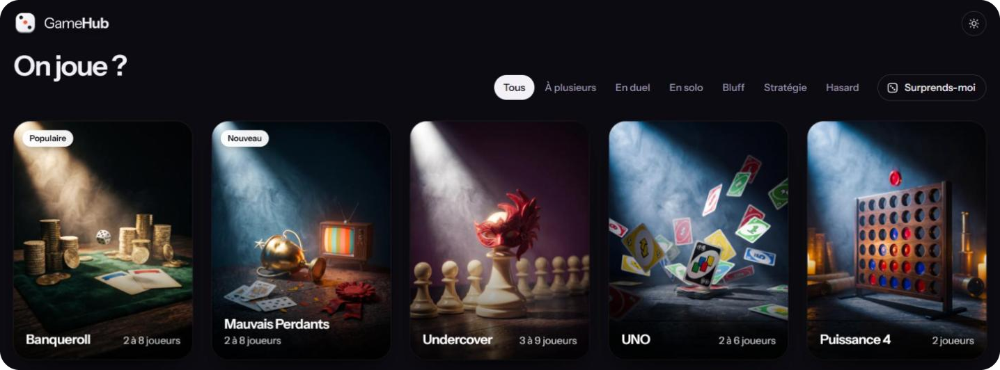

# Game Hub

Des jeux multijoueurs à lancer dans le navigateur, entre potes.

[**roulia.me**](https://roulia.me)

 

 

## Jeux

- **[Banqueroll](https://roulia.me/games/banqueroll/)** : plateau financier avec enchères, échanges, bots et présentateur IA.
- **[Mauvais Perdants](https://roulia.me/games/mauvais-perdants/)** : une émission de télé des années 70, un tournoi de mini-jeux et un solo contre le présentateur.
- **[Mini Subway](https://roulia.me/games/mini-subway/)** : trace des lignes de métro et achemine les passagers avant la saturation.
- **[UNO](https://roulia.me/games/uno/)** : pose tes cartes, bloque les autres et crie UNO.
- **[Undercover](https://roulia.me/games/undercover/)** : trouve l'imposteur avant qu'il ne te démasque.
- **[Roulette](https://roulia.me/games/roulette/)** : misez vos jetons, la roue tourne.
- **[Mini Golf](https://roulia.me/games/mini-golf/)** : 9 trous, le moins de coups gagne.
- **[Qui est-ce ?](https://roulia.me/games/qui-est-ce/)** : devine le personnage adverse.
- **[Bataille navale](https://roulia.me/games/bataille-navale/)** : place ta flotte et coule celle de l'adversaire.
- **[Puissance 4](https://roulia.me/games/puissance4/)** : aligne 4 jetons avant l'adversaire.

## Licence

© 2026 XVIIIUUUU, tous droits réservés : le code est visible mais pas libre de
réutilisation (voir [LICENSE](LICENSE)). Les noms UNO, Qui est-ce ?, Puissance 4 et
les autres jeux classiques restent des marques de leurs éditeurs respectifs.

By XVIIIUUUU

