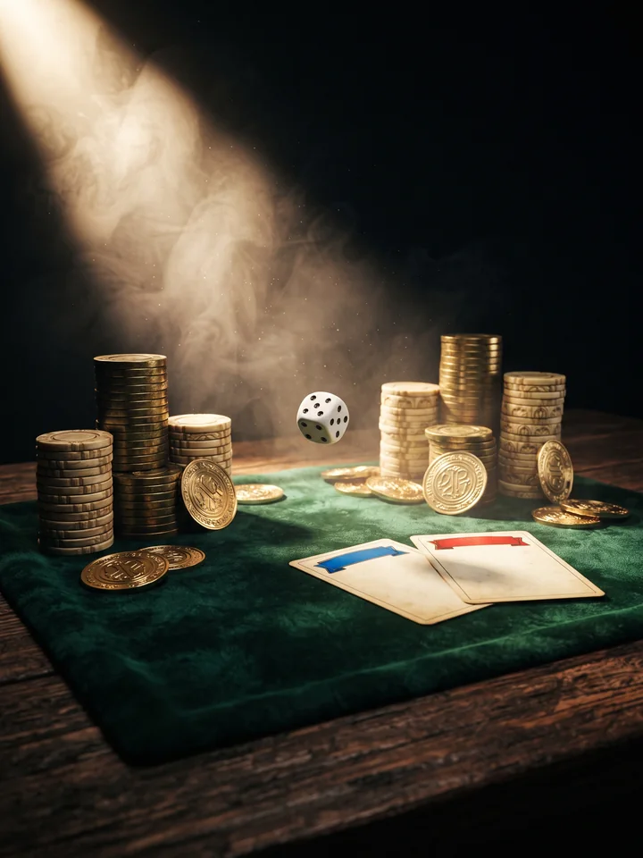
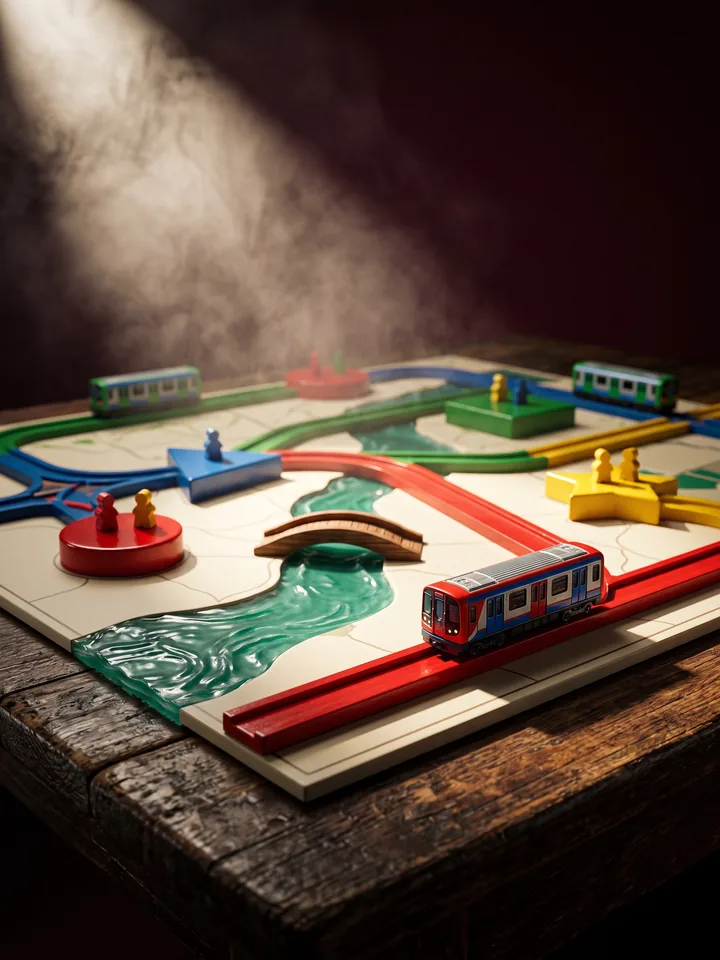
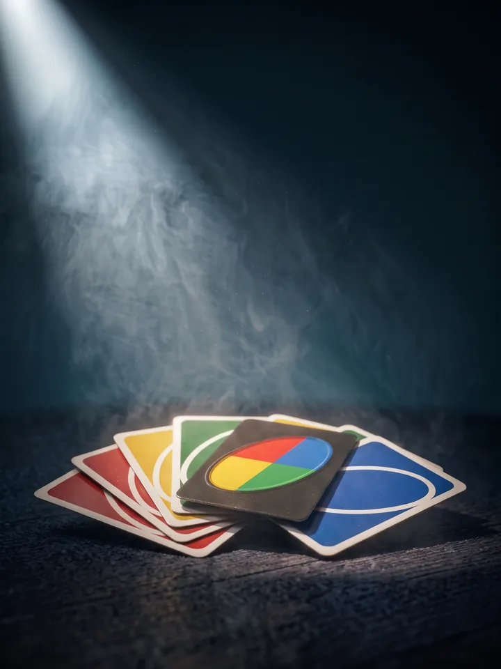
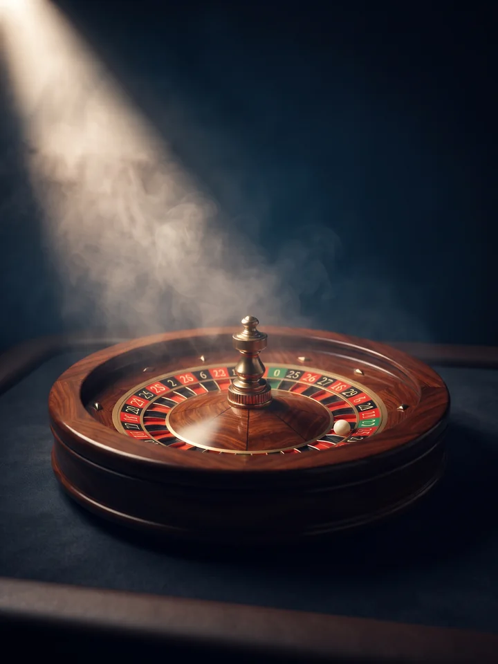
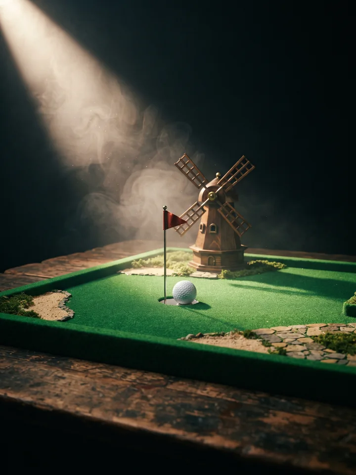
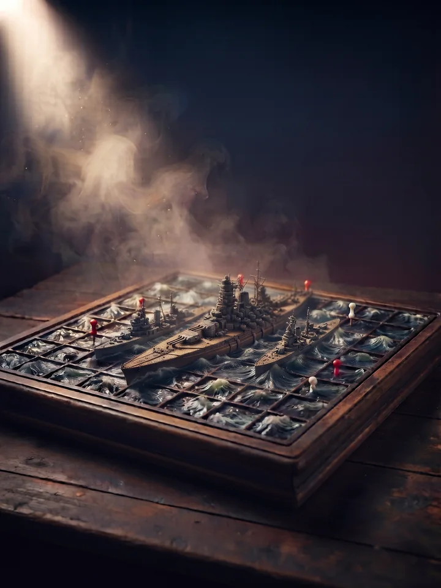
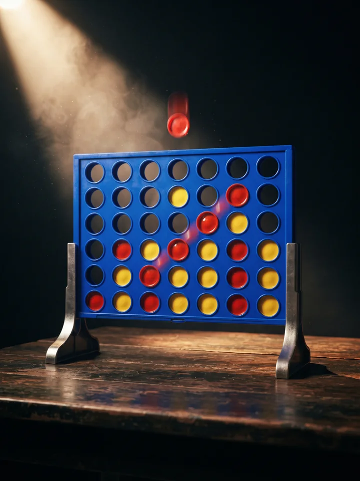

# Game Hub

### Des jeux multijoueurs à lancer dans le navigateur, entre potes.

On crée une partie, on partage le code, on joue. 
Aucune installation. Aucun compte. Que du fun.

 

 

 

 

 

## ✨ Comment ça marche

<table>
<tr>
<td align="center" width="25%"><h3>1 · Choisis</h3>un jeu sur <a href="https://roulia.me">roulia.me</a></td>
<td align="center" width="25%"><h3>2 · Crée</h3>un salon en un clic</td>
<td align="center" width="25%"><h3>3 · Partage</h3>le code à tes potes</td>
<td align="center" width="25%"><h3>4 · Joue</h3>ensemble, en direct</td>
</tr>
</table>

## 🎮 Les jeux

### 🎉 Pour les soirées

| | Jeu | Joueurs | En deux mots |
|:-:|---|:-:|---|
| 💼 | **[Banqueroll](https://roulia.me/games/banqueroll/)** | 2–8 | Plateau financier : enchères, échanges, bots, présentateur IA et modes party |
| 🎤 | **[Mauvais Perdants](https://roulia.me/games/mauvais-perdants/)** | 1–8 | Une émission de télé des années 70 : un tournoi de mini-jeux, un chat libre et un solo contre le présentateur |
| 🕵️ | **[Undercover](https://roulia.me/games/undercover/)** | 3–9 | Trouve l'imposteur avant qu'il ne te démasque |
| 🃏 | **[UNO](https://roulia.me/games/uno/)** | 2–6 | Pose tes cartes, bloque les autres et crie UNO |
| 🎰 | **[Roulette](https://roulia.me/games/roulette/)** | 2–8 | Misez vos jetons, la roue tourne |
| ⛳ | **[Mini Golf](https://roulia.me/games/mini-golf/)** | 2–4 | 9 trous, le moins de coups gagne |
| 🚇 | **[Mini Subway](https://roulia.me/games/mini-subway/)** | 1–4 | Trace des lignes de métro et achemine les passagers avant la saturation |

### ⚔️ Pour les duels

| | Jeu | Joueurs | En deux mots |
|:-:|---|:-:|---|
| 🤔 | **[Qui est-ce ?](https://roulia.me/games/qui-est-ce/)** | 2 | Devine le personnage adverse |
| ⚓ | **[Bataille navale](https://roulia.me/games/bataille-navale/)** | 2 | Place ta flotte et coule celle de l'adversaire |
| 🔴 | **[Puissance 4](https://roulia.me/games/puissance4/)** | 2 | Aligne 4 jetons avant l'adversaire |

## 🛠️ Sous le capot

Un site léger, en HTML, CSS et JavaScript natifs, sans framework, qui se joue dans n'importe quel
navigateur, sur téléphone comme sur ordinateur. Les parties se synchronisent en temps réel entre
les joueurs.

## 📜 Droits

© 2026 XVIIIUUUU, tous droits réservés : le code est visible mais pas libre de
réutilisation (voir [LICENSE](LICENSE)). Les noms UNO, Qui est-ce ?, Puissance 4 et
les autres jeux classiques restent des marques de leurs éditeurs respectifs.

 

### 🎲 Prêt à jouer ?

**[▶ roulia.me](https://roulia.me)**

Fait avec ❤️ par XVIIIUUUU

