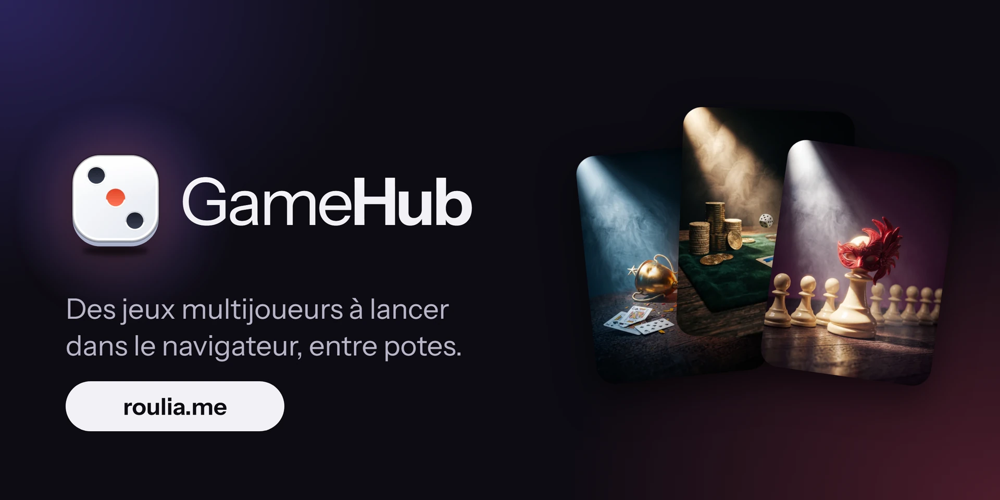
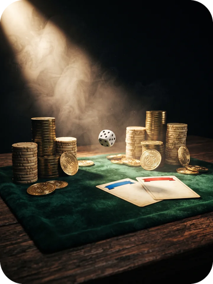
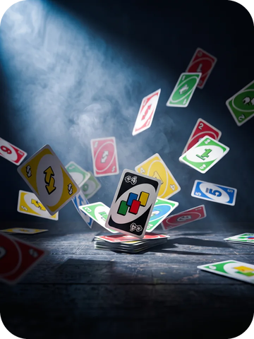
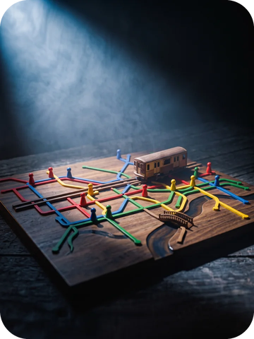
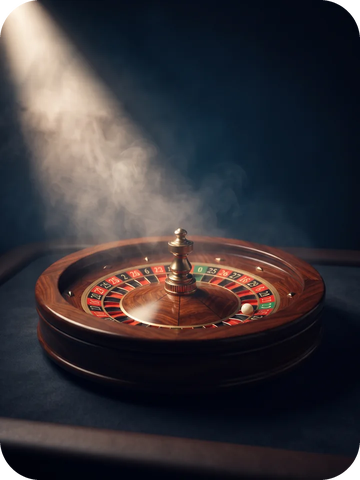
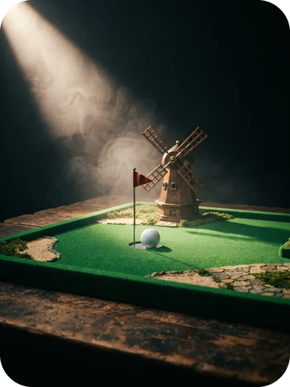
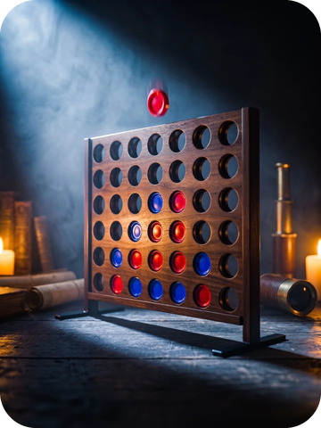
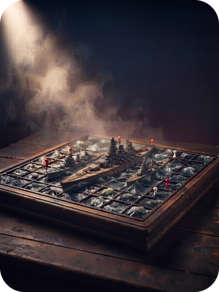

 

   

 

## Les jeux

<table>
<tr>
<td align="center" width="25%">  <b><a href="https://roulia.me/games/banqueroll/">Banqueroll</a></b> Enchères et échanges 2 à 8 joueurs  </td>
<td align="center" width="25%">  <b><a href="https://roulia.me/games/mauvais-perdants/">Mauvais Perdants</a></b> Tournoi télé des années 70 1 à 8 joueurs  </td>
<td align="center" width="25%">  <b><a href="https://roulia.me/games/undercover/">Undercover</a></b> Démasque l'imposteur 3 à 9 joueurs  </td>
<td align="center" width="25%">  <b><a href="https://roulia.me/games/uno/">UNO</a></b> Bloque et crie UNO 2 à 6 joueurs  </td>
</tr>
</table>

<table>
<tr>
<td align="center" width="25%">  <b><a href="https://roulia.me/games/echecs/">Échecs</a></b> Leçons, coach et duels 1 ou 2 joueurs  </td>
<td align="center" width="25%">  <b><a href="https://roulia.me/games/mini-subway/">Mini Subway</a></b> Trace ton réseau de métro 1 à 4 joueurs  </td>
<td align="center" width="25%">  <b><a href="https://roulia.me/games/roulette/">Roulette</a></b> Misez, la roue tourne 2 à 8 joueurs  </td>
<td align="center" width="25%">  <b><a href="https://roulia.me/games/mini-golf/">Mini Golf</a></b> 9 trous, le moins de coups 2 à 4 joueurs  </td>
</tr>
</table>

<table>
<tr>
<td align="center" width="25%">  <b><a href="https://roulia.me/games/puissance4/">Puissance 4</a></b> Aligne 4 jetons 2 joueurs  </td>
<td align="center" width="25%">  <b><a href="https://roulia.me/games/qui-est-ce/">Qui est-ce ?</a></b> Devine le personnage 2 joueurs  </td>
<td align="center" width="25%">  <b><a href="https://roulia.me/games/bataille-navale/">Bataille navale</a></b> Coule la flotte adverse 2 joueurs  </td>
</tr>
</table>

## Technologies

HTML · CSS · JavaScript · Firebase · Cloudflare · GitHub Pages

 

HTML, CSS et JavaScript natifs, sans framework ni étape de compilation. Les parties sont
synchronisées en temps réel entre les joueurs, et le site est publié par GitHub Pages.

## Sous le capot

<table>
<tr>
<td width="50%" valign="top"><b>Multijoueur en temps réel</b> Un code de salon suffit : les parties se synchronisent instantanément entre téléphones et ordinateurs, sans compte à créer.</td>
<td width="50%" valign="top"><b>Moteurs déterministes</b> Les règles de plusieurs jeux sont des modules purs, sans dépendance au navigateur : mêmes graines, mêmes parties, rejouables et testables.</td>
</tr>
<tr>
<td valign="top"><b>3D dans le navigateur</b> Le plateau de Puissance 4 est rendu en 3D avec Three.js : bois verni, pions d'émail, éclairage de scène.</td>
<td valign="top"><b>Architecture résiliente</b> Le navigateur ne parle jamais directement aux modèles d'IA : une passerelle serverless en périphérie sert d'intermédiaire. Elle enchaîne plusieurs fournisseurs en cascade avec un budget de temps par appel, puis, si tous échouent, le jeu bascule sur ses répliques locales : la partie ne s'interrompt jamais. L'IA reste cantonnée au texte, sans aucune prise sur les règles.</td>
</tr>
<tr>
<td valign="top"><b>Rendu et audio maison</b> Canvas 2D pour Mini Subway, sons et musiques synthétisés par Web Audio, tactile, souris et stylet gérés partout.</td>
<td valign="top"><b>Testé en conditions réelles</b> Des centaines de tests automatisés, dont des parties jouées par plusieurs navigateurs en même temps contre les vraies règles de sécurité de la base.</td>
</tr>
<tr>
<td valign="top"><b>Un moteur d'échecs maison</b> Règles complètes vérifiées sur les positions de référence (perft), adversaire à trois niveaux : recherche alpha-bêta dans un Web Worker, la page ne gèle jamais pendant qu'il réfléchit.</td>
<td valign="top"><b>Apprendre en jouant</b> Les Échecs ont des leçons interactives sur l'échiquier, puis une partie avec un coach qui commente chaque coup, signale les pièces en prise et propose un conseil.</td>
</tr>
</table>

## Licence

© 2026 XVIIIUUUU, tous droits réservés : le code est visible mais pas libre de
réutilisation (voir [LICENSE](LICENSE)). Les noms UNO, Qui est-ce ?, Puissance 4 et
les autres jeux classiques restent des marques de leurs éditeurs respectifs.

 
By XVIIIUUUU

